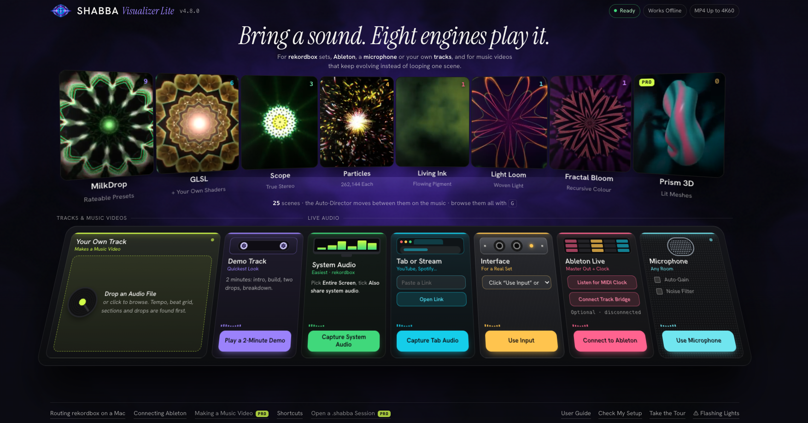
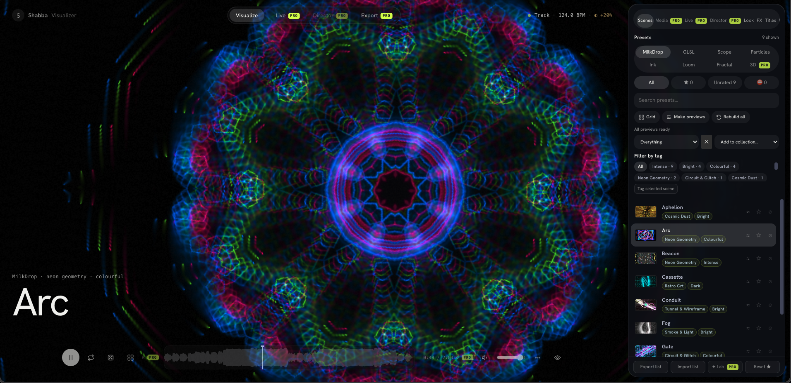

# SHABBA Visualizer

Your music already has motion. Visualizer Lite lets you see it: play a sample, load a track, connect a live source, and watch the visuals respond to the sound. The free Lite studio runs in your browser.

- [Open the studio](https://visualizer.shabbamusic.com/studio/)
- [Product overview and features](https://visualizer.shabbamusic.com)
- [SHABBA Music on YouTube](https://www.youtube.com/@ShabbaSounds)

## Start with a source

The Studio screen shows the available audio sources, including a built-in demo track, a local file, system audio, a stream, an interface, Ableton, or a microphone. No account is needed to try Lite.

The free Lite version can run in the browser. This sample track is playing through the colourful Arc scene, with the preset library and controls open.

## Your first two minutes

Open the Studio, choose **Play a 2-Minute Demo**, and pick a scene. Press **P** to open the controls while the track plays. Try a different scene and watch how the same music changes character.

## Free in the browser

The site describes a free tier with no account. It includes 25 selected scenes across seven engines, visual response to system audio, browser audio, microphone, or a file, beat-reactive effects, eight trigger pads, colour looks, and full-screen visuals. The site labels this tier for personal use.

## Pro features

The site lists Pro as coming soon and invites users to join a waitlist. Planned Pro features include the full scene library, Director timeline, Live performance controls, MIDI, projection mapping, video export up to 4K, and use of personal media. The site says Pro is intended to include a commercial license for gigs and client work; check the current terms before relying on that.

## Export

The product page describes exports in 16:9, 9:16, 1:1, and 4:5 aspect ratios, from 720p to 4K at 30 or 60 fps. These export controls are listed as Pro features.

## Privacy and permissions

The free tier runs in the browser. Audio input can use system audio, a browser tab, an interface or loopback, Ableton, a microphone, or a file; the browser may ask for the relevant permission. Review the product's current privacy terms before using sensitive or third-party audio.

## Help and updates

For product details, visit the [Visualizer site](https://visualizer.shabbamusic.com). Report reproducible problems in [GitHub Issues](https://github.com/Shabbamusic/shabba-visualizer/issues), including browser, operating system, audio input, and steps to reproduce.

Explore [ARCLINE](https://set.shabbamusic.com), [Ref2Set](https://github.com/Shabbamusic/ref2set), [SHABBA Plugins](https://github.com/Shabbamusic/shabba-plugins), [Audio](https://audio.shabbamusic.com), and the [SHABBA hub](https://shabbamusic.com).

## License and source availability

The product website does not establish the source-code license or redistribution terms. Add those after confirming whether this repository contains source, documentation, or a download page and what rights apply.
